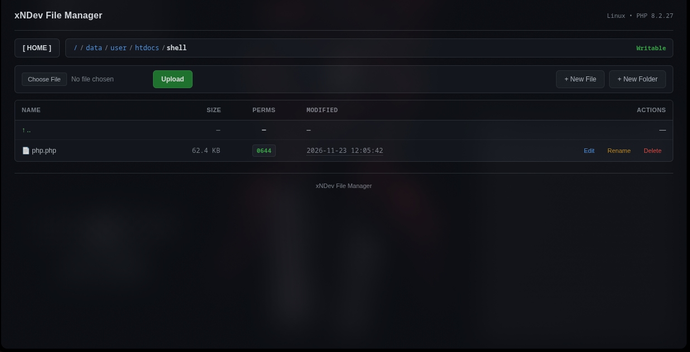

# Simple File Manager

A lightweight, single-file PHP file manager with a clean and responsive UI.

## Features

- 📁 Browse, create, edit, rename, and delete files & folders
- 📱 Responsive UI for mobile / tablet / desktop
- 🔒 Chmod (permissions) editor
- 📦 Single PHP file — just upload and use

## Screenshot

## Usage

Upload `php.php` to your web server and open it in a browser.
